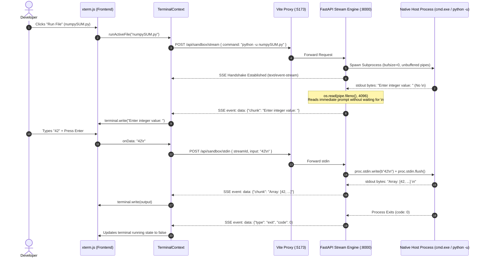
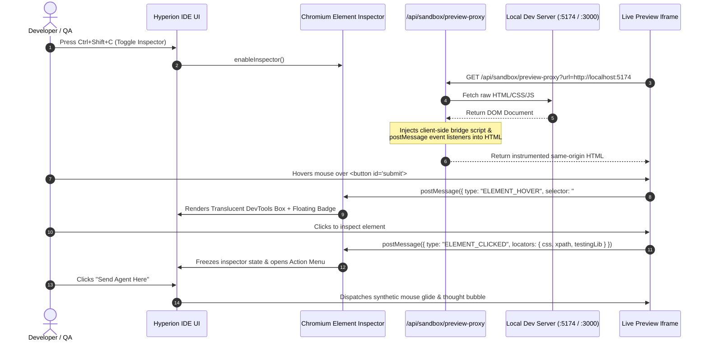
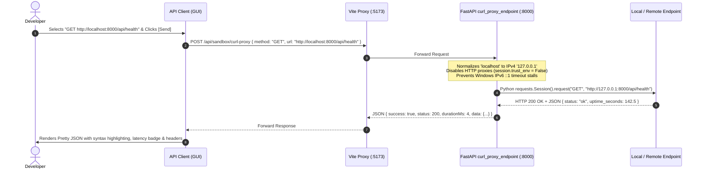
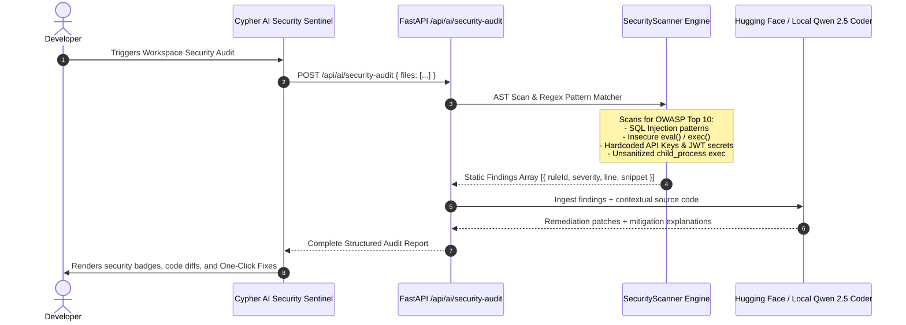

# Hyperion IDE — Database Schema, Data Models & End-to-End System Dataflow

> **Document Version:** 3.2.0  
> **System Status:** Production Ready (Python FastAPI Backend + React 19 Frontend)  
> **Target Audience:** Core Architecture Engineers, Full-Stack Developers, Database Administrators, Security Auditors

---

## 1. Architectural Data Strategy & Storage Hierarchy

Hyperion IDE operates on a resilient **hybrid persistence architecture** designed for high-performance browser IDE workflows without requiring an external database cluster for core operations, while maintaining native support for parsing, visualizing, and interacting with production database schemas (MongoDB, Mongoose, SQL).

```
+--------------------------------------------------------------------------------------------------+
|                                     HYPERION STORAGE HIERARCHY                                   |
+------------------------------------+----------------------------------+--------------------------+
| Layer 1: Client Storage            | Layer 2: In-Memory / Virtual FS  | Layer 3: Backend Runtime |
| - localStorage                     | - Virtual File System (VFS) AST  | - OS File System Sandboxes|
| - Session Storage                  | - In-Memory Buffer Cache         | - Stateful REPL Processes|
| - File System Access API Handles   | - Unbuffered Process Stream Pipes| - Selenium WebDriver Tree|
+------------------------------------+----------------------------------+--------------------------+
```

---

## 2. Client-Side Data Models & Storage Schema

Client-side state persistence is managed through deterministic key namespaces within browser `localStorage` and memory context stores.

### 2.1. Client Key Contracts (`localStorage`)

| Storage Key | Data Type | Default / Schema Example | Description |
| :--- | :--- | :--- | :--- |
| `hyperion_theme` | `String` | `"pixelatte-light"` | Active UI theme ID across the application. |
| `hyperion_settings` | `JSON Object` | `{"editor.fontSize": 14, "workbench.colorTheme": "pixelatte-light", ...}` | Comprehensive user configuration settings. |
| `hyperion_workspace_state` | `JSON Object` | `{"openFileIds": [...], "activeFileId": "...", "splitLayout": "single"}` | Active editor tabs, cursor locations, split-view states. |
| `hyperion_api_client_history` | `JSON Array` | `[{"id": 179466, "method": "GET", "url": "...", "status": 200}]` | History log of executed API requests and latency metrics. |
| `hyperion_api_client_environments` | `JSON Object` | `{"current": "local", "variables": {"baseUrl": "http://127.0.0.1:8000"}}` | Key-value environment variable dictionary for cURL tests. |
| `hyperion_git_credentials` | `JSON Object` | `{"username": "...", "token": "ghp_..."}` | Ephemeral Git authentication tokens for remote sync. |
| `hyperion_terminals_state` | `JSON Array` | `[{"id": "term_1", "type": "pwsh", "title": "pwsh 1"}]` | Open terminal session metadata and tab configurations. |
| `hyperion_repl_history` | `JSON Array` | `[{"runtime": "python", "history": ["import math", "math.pi"]}]` | Multi-line REPL input history. |

### 2.2. Virtual File System (VFS) Node Model

```typescript
interface VirtualFileNode {
  id: string;                       // Deterministic UUID or path hash (e.g., "file_main_py_8921")
  name: string;                     // File name with extension (e.g., "numpySUM.py")
  path: string;                     // Absolute or workspace-relative path ("src/numpySUM.py")
  type: "file" | "directory";      // Node categorization
  content?: string | null;          // UTF-8 text content or base64 data URI for binary media
  size: number;                     // File byte count
  lastModified: number;             // Epoch millisecond timestamp
  isDirty: boolean;                 // Unsaved modifications flag
  isOpen: boolean;                  // Active tab open flag
  languageId: string;               // Language identifier for Monaco ("python", "c", "javascript")
  children?: VirtualFileNode[];     // Directory child tree nodes
}
```

---

## 3. Backend Data Models (FastAPI & Pydantic)

The Python FastAPI backend (`backend/`) strictly validates all inbound execution, streaming, and testing payloads using Pydantic models.

### 3.1. Subprocess Execution & SSE Streaming Models

```python
from pydantic import BaseModel, Field
from typing import Optional, Dict, Any, List

class ExecutionRequest(BaseModel):
    command: Optional[str] = Field(None, description="Direct shell command to invoke")
    filePath: Optional[str] = Field(None, description="Target workspace file to execute")
    fileName: Optional[str] = Field(None, description="Basename of the executable file")
    cwd: Optional[str] = Field(None, description="Working directory path")
    runtime: Optional[str] = Field("python", description="python | c | cpp | node | bash")
    args: Optional[List[str]] = Field(default_factory=list, description="Command line arguments")

class StreamChunk(BaseModel):
    streamId: str
    channel: str = Field("stdout", description="stdout | stderr | system | exit")
    chunk: str
    timestamp: float

class StdinPayload(BaseModel):
    streamId: str
    input: str = Field(..., description="Raw keystroke or line input to write to child stdin")

class ProcessTerminationRequest(BaseModel):
    streamId: str
    force: bool = False
```

### 3.2. REPL Session State Model

```python
class ReplStartRequest(BaseModel):
    sessionId: str
    runtime: str = Field("python", description="python | node | bash")
    cwd: Optional[str] = None

class ReplEvalRequest(BaseModel):
    sessionId: str
    code: str = Field(..., description="Line or block of code to evaluate in active session")

class ReplEvalResponse(BaseModel):
    success: bool
    output: str
    error: Optional[str] = None
    sessionId: str
```

### 3.3. API Client & cURL Proxy Model

```python
class CurlProxyRequest(BaseModel):
    method: str = Field("GET", description="HTTP Method: GET, POST, PUT, DELETE, PATCH, etc.")
    url: str = Field(..., description="Target URL (handles localhost & remote targets)")
    headers: Optional[Dict[str, str]] = Field(default_factory=dict)
    body: Optional[Any] = None
    timeoutMs: Optional[int] = Field(30000, description="Read timeout in milliseconds")

class CurlProxyResponse(BaseModel):
    success: bool
    status: int
    statusText: str
    durationMs: int
    sizeBytes: int
    headers: Dict[str, str]
    data: Any
    rawText: str
    error: Optional[str] = None
```

### 3.4. Autonomous QA Agent & Testing Models

```python
class QATestStep(BaseModel):
    stepIndex: int
    action: str = Field(..., description="navigate | scroll | click | type | assert | audit")
    targetSelector: Optional[str] = None
    value: Optional[str] = None
    status: str = Field("pending", description="pending | running | passed | failed")
    durationMs: Optional[int] = 0
    error: Optional[str] = None

class QAReport(BaseModel):
    testSuiteId: str
    targetUrl: str
    timestamp: int
    durationTotalMs: int
    healthScore: int = Field(..., ge=0, le=100)
    totalSteps: int
    passedSteps: int
    failedSteps: int
    steps: List[QATestStep]
    consoleErrors: List[str]
    auditSummary: Dict[str, Any]
```

### 3.5. Security Scanner (SAST) Finding Model

```python
class SecurityFinding(BaseModel):
    ruleId: str                     # e.g., "SEC-OWASP-INJ-01"
    category: str                   # Injection, Broken Auth, Hardcoded Secret, etc.
    severity: str                   # CRITICAL | HIGH | MEDIUM | LOW | INFO
    filePath: str
    lineNumber: int
    codeSnippet: str
    vulnerability: str
    remediation: str
    cweId: Optional[str] = None     # e.g., "CWE-89"
    owaspTop10: Optional[str] = None # e.g., "A03:2021-Injection"
```

---

## 4. AST MongoDB & Mongoose Schema Parser Engine

Hyperion IDE features an intelligent AST-based schema parser (`src/services/mongoSchemaParser.js`) that dynamically extracts schema entities, attributes, constraints, and relationships directly from user code without requiring an active database connection.

### 4.1. Entity-Relationship Data Model

```
+--------------------+            1 : N            +--------------------+
|    UserModel       | --------------------------> |    OrderModel      |
+--------------------+                             +--------------------+
| _id: ObjectId [PK] |                             | _id: ObjectId [PK] |
| username: String   |                             | userId: ObjectId[FK|
| email: String      |                             | total: Number      |
| role: String       |                             | status: String     |
| createdAt: Date    |                             | createdAt: Date    |
+--------------------+                             +--------------------+
```

### 4.2. Schema Representation Schema

```typescript
interface SchemaEntity {
  name: string;                     // Model name (e.g. "User", "Project", "Order")
  collection: string;               // Database collection name ("users")
  fields: Record<string, SchemaField>;
  indexes: Array<{ fields: string[]; unique?: boolean }>;
  relations: SchemaRelation[];
}

interface SchemaField {
  name: string;
  type: "ObjectId" | "String" | "Number" | "Boolean" | "Date" | "Array" | "Object" | "Mixed";
  required: boolean;
  unique?: boolean;
  default?: any;
  ref?: string;                     // Target model referenced by ObjectId
}

interface SchemaRelation {
  type: "one-to-one" | "one-to-many" | "many-to-many";
  sourceModel: string;
  sourceField: string;
  targetModel: string;
  targetField: string;
}
```

---

## 5. End-to-End System Dataflow Diagrams

### 5.1. Terminal Execution & Unbuffered SSE Streaming Dataflow

This flow resolves terminal input prompt blocking and guarantees real-time interactive execution for commands like Python `input()` or C `scanf()`.



---

### 5.2. Live Browser Reverse Proxy & Element Inspector Dataflow



---

### 5.3. Autonomous QA Agent & Selenium Automation Flow

```mermaid
sequenceDiagram
    autonumber
    actor QA as QA Engineer
    participant Agent as Autonomous QA Agent (Browser / Backend)
    participant Driver as Selenium 4 Controller
    participant Browser as Chrome Instance (Headless / Headed)
    participant Scorer as Application Health Scorer

    QA->>Agent: Launch Autonomous Test Patrol
    Agent->>Driver: Initialize WebDriver session (window: 1280x800)
    Driver->>Browser: Navigate to target URL
    
    loop Exploration Patrol
        Agent->>Browser: Natural Mousewheel Scroll down & up
        Browser-->>Agent: Rendered viewports & DOM mutations
        
        Agent->>Browser: Discover internal links (/#skills, /#projects, /#contact)
        Agent->>Browser: Sequentially click and verify route state transitions
        
        Agent->>Browser: Identify forms (<form>)
        Agent->>Browser: Submit empty inputs (Boundary validation test)
        Browser-->>Agent: Assert validation messages render without crash
        
        Agent->>Browser: Inject realistic synthetic keystrokes
        Browser-->>Agent: Assert submission confirmation feedback
    end

    Browser-->>Agent: Collect DOM logs, network failures, console errors
    Agent->>Scorer: Submit telemetry payload
    Note over Scorer: Computes Health Score (0-100)<br/>Deducts points for unhandled 500s,<br/>console exceptions, and broken routes
    Scorer-->>QA: Generates TEST_REPORT.md, HTML visual log, and JSON metrics
```



---

### 5.4. API Client & cURL Testing Proxy Flow



---

### 5.5. Static Application Security Testing (SAST) & Cypher AI Flow



---

## 6. Concurrency, Race Conditions & State Synchronization

1. **Subprocess Stream Unbuffering**:
   * Child processes run with `bufsize=0` on both backend read and stdin write.
   * `os.read(pipe.fileno(), 4096)` is executed in background worker threads managed via `concurrent.futures.ThreadPoolExecutor`, isolating blocking pipe I/O from FastAPI's asyncio event loop.
2. **Terminal Keystroke Synchronization**:
   * React's `terminal.onData` handler leverages mutable React references (`isRunningRef`, `activeTerminalRef`) to eliminate stale closures when routing user keystrokes to active stdin streams.
3. **Loopback Connection Deadlock Prevention**:
   * Requests originated by the frontend API Client testing backend endpoints on the same port (e.g. `8000`) are processed through asynchronous executor threads with explicit IPv4 substitution (`127.0.0.1`) and `session.trust_env = False` to prevent proxy re-routing deadlocks.
4. **Virtual File Tree Dirty Flagging**:
   * Editor buffer mutations update in-memory state with a 300ms debounce before dispatching dirty state notifications to the tab bar, avoiding layout thrashing during fast typing.
