# Hyperion IDE — Comprehensive Project Overview & System Architecture

> **Document Version:** 3.2.0
> **Status:** Production Specification
> **Target Audience:** All Engineers, Architects, Technical Stakeholders, Contributors

---

## 1. Executive Summary

**Hyperion IDE** is a high-performance, full-stack browser-based integrated development environment and autonomous testing suite. Built on a modern React 19 frontend and an ultra-fast Python FastAPI backend, Hyperion bridges the gap between cloud accessibility and desktop-native power.

Unlike traditional browser IDEs that rely on sluggish container spin-ups or limited mocked sandboxes, Hyperion connects directly to your native operating system host. It provides:

1. **Unbuffered Native Terminal Execution**: Direct access to host shells (PowerShell, Command Prompt, Bash) with immediate interactive `stdin`/`stdout` streaming.
2. **Autonomous QA Testing Studio**: An automated agent powered by Selenium 4 and visual cursor emulation that tests live web applications like a real human user.
3. **Integrated API Client & cURL Proxy**: An in-IDE Postman alternative with automated CORS bypass and localhost loopback optimization.
4. **Chromium-Grade Element Inspector**: An overlay tool that extracts CSS/XPath/Testing Library locators with one-click agent targeting.
5. **3D Architecture & Database Visualizer**: Interactive Three.js WebGL execution flow diagrams and automatic AST-driven MongoDB/Mongoose ERD generation.
6. **Cypher AI Security Sentinel**: Static Application Security Testing (SAST) auditing code against OWASP Top 10 vulnerabilities.
7. **Signature Pixelatte Design System**: Over 30 themes highlighted by the retro-arcade **Pixelatte** (Dark) and **Pixelatte Light** (Gameboy Cream) aesthetic.

---

## 2. High-Level System Architecture

```mermaid
graph TD
    subgraph Frontend ["Client Layer: React 19 Browser Workspace (:5173)"]
        UI[Hyperion IDE Shell]
        Monaco[Monaco Code Editor]
        Xterm[xterm.js Native Terminal]
        Three[Three.js 3D Architecture Canvas]
        Inspector[Chromium Element Inspector]
        ApiClient[API Client & cURL Studio]
        GitUI[Source Control Git Manager]
        QAGUI[Autonomous QA Studio]
        ThemeEngine[Dynamic Multi-Theme Engine]
    end

    subgraph Transport ["Transport & Gateway Layer"]
        Vite[Vite Dev Server & Reverse Proxy :5173]
        SSE[Server-Sent Events Stream Bus]
        ProxyRoute["/api/sandbox/preview-proxy & curl-proxy"]
    end

    subgraph Backend ["Backend Runtime Layer: FastAPI Python Engine (:8000)"]
        RouterMain[FastAPI Core Router]
        StreamEngine[StreamEngine: Unbuffered Process Spawner]
        SandboxEngine[SandboxEngine: Compilers & VFS]
        REPLEngine[REPLEngine: Multi-Language Sessions]
        SeleniumEngine[Selenium 4 WebDriver Controller]
        QAAgent[QA Agent: Human Emulation & Scoring]
        SASTScanner[SecurityScanner: OWASP AST Engine]
    end

    subgraph AI ["AI & Security Intelligence Layer"]
        HFRouter[Hugging Face Inference Router]
        LocalQwen[Local Qwen 2.5 Coder Model on CPU]
        CypherAI[Cypher AI Security Sentinel]
    end

    subgraph Host ["Host Operating System & Native Tools"]
        OSShell["Native Shell: cmd.exe / powershell / bash"]
        Toolchains["Compilers & Runtimes: Python, Node, GCC, G++, Java"]
        GitCLI[Git Command Line Interface]
        BrowserInstance[Chrome / Edge WebDriver Instance]
        FileSystem[Local Workspace Disk]
    end

    %% Connections
    UI --> Vite
    Monaco --> Vite
    Xterm --> SSE
    ApiClient --> ProxyRoute
    QAGUI --> Vite

    Vite --> RouterMain
    SSE --> StreamEngine
    ProxyRoute --> SandboxEngine

    RouterMain --> StreamEngine
    RouterMain --> SandboxEngine
    RouterMain --> REPLEngine
    RouterMain --> SeleniumEngine
    RouterMain --> SASTScanner

    SeleniumEngine --> QAAgent
    SASTScanner --> CypherAI
    CypherAI --> HFRouter
    CypherAI --> LocalQwen

    StreamEngine --> OSShell
    SandboxEngine --> Toolchains
    SandboxEngine --> FileSystem
    SeleniumEngine --> BrowserInstance
    GitUI --> GitCLI
```



---

## 3. Core Modules & Subsystem Breakdown

### 3.1. Code Editing & Virtual Filesystem Subsystem

* **Monaco Editor Engine**: Integrates `@monaco-editor/react` with VS Code-grade autocomplete, parameter hints, snippet expansion, minimap navigation, multi-cursor editing, and bracket matching.
* **Virtual File System (VFS)**: Manages in-memory file trees and persists changes via the File System Access API. Handles syntax diagnostics and linting markers across JavaScript, TypeScript, Python, and C/C++.
* **Media Renderers**: Built-in support for Jupyter Notebooks (`.ipynb`), CSV/XLSX spreadsheets, Word documents (`.docx`), Markdown preview, and binary media (images, audio, video).

### 3.2. Native Host Execution & Stream Engine

* **Unbuffered Subprocess Execution**: Backend processes run with `bufsize=0`. Output chunks are retrieved using non-blocking byte reads (`os.read(pipe.fileno(), 4096)`) inside worker threads.
* **Prompt Non-Blocking Architecture**: Programs requesting console input without trailing newlines (e.g. `input("Enter integer value: ")`) stream immediately to xterm.js instead of hanging.
* **Direct Shell Routing**: On Windows, script runs dispatch via `cmd.exe /d /s /c` to bypass PowerShell object-pipeline buffering, while PowerShell commands run natively.
* **Bidirectional Interactive Stdin**: Keystrokes from xterm.js are captured via `terminal.onData` and transmitted via `POST /api/sandbox/stdin` with automatic UTF-8 byte encoding and flushing.
* **Console Output Sanitizer**: Filters raw ANSI escape sequences while strictly preserving newlines (`\n`) and tab indents (`\t`) for structured multi-line compiler outputs.

### 3.3. Autonomous QA Agent & Selenium Automation Studio

* **Selenium 4 WebDriver Controller**: Automates real browser sessions (Chrome/Edge/Firefox) in both headed and headless modes.
* **Natural Human Emulation**:
  * Physics-smoothed mousewheel scrolling to audit lazy-loaded assets and footer layouts.
  * Route traversal discovering and testing internal anchors (`/#skills`, `/#projects`, `/#contact`).
  * Boundary form validation testing empty submissions followed by realistic synthetic keystroke entry.
  * Interactive control resiliency testing buttons, accordions, theme switches, and modals.
* **Visual AI Cursor**: Renders an animated cursor in the live preview with expanding click ripples and speech bubble thoughts.
* **Automated Audit Reports**: Computes a 0-100 Health Score and generates structured Markdown (`TEST_REPORT.md`), HTML, and JSON audit metrics.

### 3.4. Chromium-Style Element Inspector

* **Live DOM Overlay**: Injects an instrumentation bridge into preview iframes to calculate accurate element bounding boxes.
* **DevTools Badge**: Displays tag names, IDs, class lists, computed pixel dimensions, and accessibility roles on hover.
* **Click-to-Freeze**: Freezes element inspection on click without navigating the browser or triggering form submits.
* **Robust Locator Generation**: Extracts optimal CSS selectors, full XPath routes, and semantic Testing Library locators (`By.role(...)`, `By.text(...)`).
* **Agent Integration**: One-click "Send Agent Here" commands the Autonomous QA cursor to glide to the inspected element.

### 3.5. Integrated API Client & cURL Tester

* **Postman-Grade Workbench**: Supports `GET`, `POST`, `PUT`, `DELETE`, `PATCH`, `HEAD`, `OPTIONS` with headers, query parameters, and JSON/Form request bodies.
* **CORS-Bypass cURL Proxy**: Routes requests through `/api/sandbox/curl-proxy` via Python `requests.Session()`.
* **Localhost Loopback Optimization**: Automatically rewrites `localhost` to IPv4 `127.0.0.1` and sets `session.trust_env = False` to prevent Windows IPv6 timeout stalls.
* **cURL Import**: Parses pasted raw cURL command lines into method, URL, headers, and body automatically.
* **AI Security Analysis**: Inspects returned JSON payloads for leaked credentials, SQL error traces, and schema mismatches.

### 3.6. Source Control & Git UI

* **Branch Management**: Displays current branch, remote tracking status (`ahead / behind`), and branch creation/switching controls.
* **Staging Trees**: Grouped views for Staged Changes, Unstaged Changes, and Untracked Files.
* **Monaco Diff Viewer**: Side-by-side or inline visual diffs with line-by-line comparison.
* **AI Commit Generator**: Analyzes pending git diffs and drafts concise conventional commit messages automatically.

### 3.7. 3D Architecture Visualizer & Mongo ERD

* **Three.js WebGL Topology**: Interactive 3D component mesh with orbit controls, spatial layer grouping, and animated particle trails tracing execution flows.
* **AST MongoDB Schema Parser**: Statically analyzes code to extract Mongoose schemas, primary/foreign keys, indexes, and relationships (1:1, 1:N, N:M) into an interactive SVG ER diagram.
* **Backend API Matrix**: Statically parses FastAPI and Express route files to generate an endpoint table.

### 3.8. Cypher AI & SAST Security Sentinel

* **Static Application Security Testing (SAST)**: Scans source code for OWASP Top 10 vulnerabilities, injection flaws, hardcoded credentials, and unsafe system calls.
* **Severity Scoring**: Categorizes findings by severity (`CRITICAL`, `HIGH`, `MEDIUM`, `LOW`) with code snippets, line numbers, and CWE references.
* **Dual Model Pipeline**: Supports local inference via Qwen 2.5 Coder on CPU or cloud routing via Hugging Face Inference API.

### 3.9. Signature Pixelatte Design System

* **Retro 8-Bit Arcade Aesthetic**:
  * Dark Mode (`pixelatte`): Deep violet (`#0f0728`), 8-bit coin yellow (`#ffff00`), 1-Up cyan (`#00f5d4`), arcade gold (`#facc15`), and magenta (`#ff007f`).
  * Light Mode (`pixelatte-light`): Gameboy cartridge cream (`#eae6d9`), retro ink charcoal (`#1f1d16`), brass gold (`#f59e0b`), and berry red (`#c90057`).
  * Absolute `0px` radius on all controls and hard solid drop shadows (`4px 4px 0px`).
  * Custom pixel typography via Google Fonts `'Pixelify Sans'` and `'Press Start 2P'`.

---

## 4. Technology Stack Matrix

| Domain                         | Technology / Library                                                      | Version      | Purpose                                                |
| :----------------------------- | :------------------------------------------------------------------------ | :----------- | :----------------------------------------------------- |
| **Frontend Framework**   | React                                                                     | `19.3.1`   | Reactive component UI and hooks                        |
| **Build & Dev Server**   | Vite                                                                      | `7.2.4`    | Ultra-fast HMR and proxy bundling                      |
| **Code Editor**          | Monaco Editor                                                             | `0.57.0`   | Desktop-grade code editor engine                       |
| **React Monaco Wrapper** | `@monaco-editor/react`                                                  | `4.7.0`    | React lifecycle integration for Monaco                 |
| **Terminal Emulator**    | `@xterm/xterm`                                                          | `6.0.0`    | High-performance ANSI terminal renderer                |
| **Terminal Addons**      | `@xterm/addon-fit`, `@xterm/addon-search`, `@xterm/addon-web-links` | `Latest`   | Auto-sizing, text search, and URL clicking             |
| **3D Graphics**          | Three.js                                                                  | `0.186.1`  | WebGL 3D architectural mesh visualization              |
| **Layout Resizing**      | `react-resizable-panels`                                                | `2.1.7`    | Fluid multi-pane resizing (sidebar, bottom panel)      |
| **Animation Engine**     | `framer-motion`                                                         | `12.43.0`  | Fluid UI transitions and modal animations              |
| **Document Parsers**     | `xlsx`, `papaparse`, `mammoth`, `jszip`                           | `Latest`   | Spreadsheets, CSV, Word, and zip archive preview       |
| **Backend Framework**    | FastAPI                                                                   | `0.115.0+` | High-performance async Python backend                  |
| **ASGI Web Server**      | Uvicorn                                                                   | `0.30.0+`  | ASGI event-loop server with SSE support                |
| **Browser Automation**   | Selenium 4                                                                | `4.25.0+`  | Real browser WebDriver automation and QA agent         |
| **HTTP Client (Python)** | Requests                                                                  | `2.32.0+`  | Loopback-isolated cURL proxy and network calls         |
| **Data Validation**      | Pydantic                                                                  | `2.8.0+`   | Strict schema validation for all API requests          |
| **Typography**           | Google Fonts                                                              | Web          | `Pixelify Sans`, `Press Start 2P`, `Roboto Mono` |

---

## 5. Repository Directory Structure Matrix

```
WebIDE/
├── backend/                     # Production FastAPI Python Backend (:8000)
│   ├── routers/
│   │   ├── ai.py                # Cypher AI, security audit & model endpoints
│   │   ├── health.py            # Health diagnostics & system telemetry
│   │   ├── sandbox.py           # SSE streaming, execution, cURL proxy, REPL & VFS
│   │   └── selenium.py          # Selenium 4 browser controller & QA agent
│   ├── services/
│   │   ├── local_ai.py          # Hugging Face & Qwen 2.5 Coder local inference
│   │   ├── qa_agent.py          # Autonomous QA agent test runner & scoring
│   │   ├── repl_engine.py       # Stateful multi-language REPL manager
│   │   ├── sandbox_engine.py    # Multi-language compiler & process sandbox
│   │   ├── security_scanner.py  # SAST engine & OWASP Top 10 rule matcher
│   │   ├── selenium_engine.py   # WebDriver driver manager & DOM actions
│   │   ├── stream_engine.py     # Unbuffered SSE streaming & non-blocking stdin
│   │   └── test_runner.py       # Test framework runner (pytest, jest, etc.)
│   ├── config.py                # Host, port, proxy bypass, and model settings
│   ├── main.py                  # Backend ASGI entry point & lifespan manager
│   └── requirements.txt         # Python dependencies
├── docs/                        # Complete Engineering Documentation Suite
│   ├── DATABASE_SCHEMA_DATAFLOW.md # Storage schemas, models & dataflow diagrams
│   ├── PDD.md                   # Product Design Document & Pixelatte design system
│   ├── PRD.md                   # Product Requirements Document & functional specs
│   ├── PROJECT_OVERVIEW.md      # Comprehensive architecture & module breakdown
│   ├── README.md                # Documentation portal & quickstart guide
│   └── USER_MANUAL.md           # User operations manual & developer guide
├── src/                         # Frontend React 19 Client (:5173)
│   ├── components/
│   │   ├── ApiClient/           # Postman-style API client & cURL tester
│   │   ├── Architecture/        # Three.js 3D canvas, Mongo ERD & route matrix
│   │   ├── BottomPanel/         # Multi-tab bottom panel (Terminal, Output, etc.)
│   │   ├── Breadcrumb/          # File path & symbol navigation bar
│   │   ├── Chat/                # Cypher AI Security Sentinel interface
│   │   ├── CommandPalette/      # Ctrl+Shift+P quick command search
│   │   ├── Editor/              # Monaco Editor wrapper & theme synchronizer
│   │   ├── Explorer/            # File tree with inline creation & drag-drop
│   │   ├── LiveBrowser/         # In-IDE simple browser previewer
│   │   ├── Navbar/              # Top menu bar, run controls, and branding
│   │   ├── Output/              # Structured console with gutter & stream filters
│   │   ├── RunDebug/            # Autonomous QA Studio & Selenium Runner
│   │   ├── Sidebar/             # Activity bar & gear Manage menu
│   │   ├── SourceControl/       # Git source control, diffs & AI commits
│   │   ├── Statusbar/           # Status bar with branch, AI sentinel & theme
│   │   └── Terminal/            # xterm.js native shell integration
│   ├── context/
│   │   ├── EditorContext.jsx    # Tab state, split layouts & problem markers
│   │   ├── FileContext.jsx      # Workspace directories & VFS persistence
│   │   ├── TerminalContext.jsx  # Native terminal sessions & streaming router
│   │   └── ThemeContext.jsx     # 30+ themes & dynamic CSS property injector
│   ├── data/
│   │   ├── commands.json        # Shell command references
│   │   ├── settings.json        # Default configuration settings
│   │   └── themes.json          # Complete theme definitions including Pixelatte
│   ├── services/                # Frontend API services & AST parsers
│   ├── styles/
│   │   ├── pixelatte.css        # Full 8-bit arcade (Dark & Light) styling rules
│   │   └── variables.css        # Base theme variables & design tokens
│   ├── App.jsx                  # Root layout orchestrator
│   └── main.jsx                 # React DOM mount with context providers
├── index.html                   # HTML shell with Google Fonts
├── package.json                 # Frontend dependencies & npm scripts
└── vite.config.js               # Vite config with backend proxy to :8000
```
